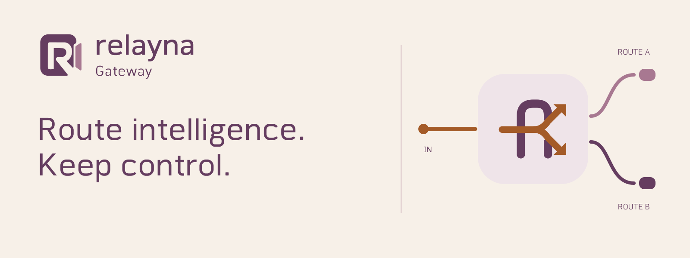
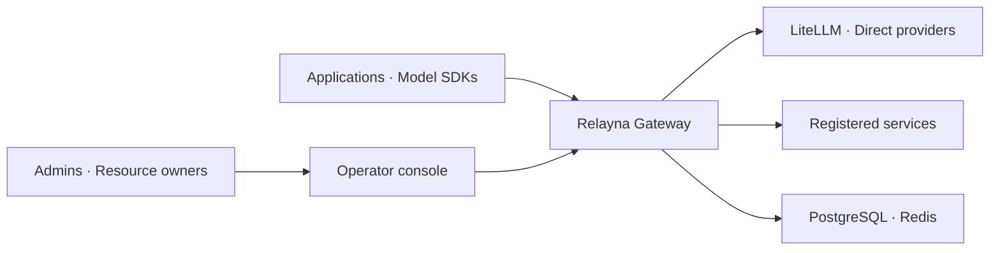
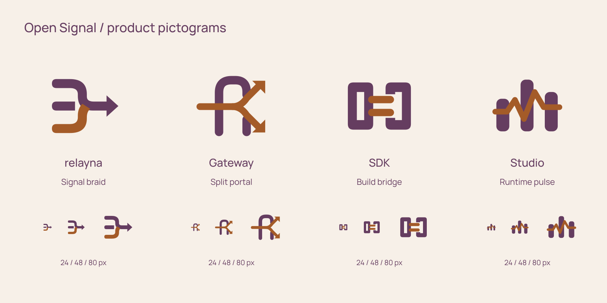

<picture>
  <source media="(prefers-color-scheme: dark)" srcset="docs/assets/brand/banners/relayna-gateway-wide-dark.svg">
  
</picture>

# Relayna Gateway

**Route intelligence. Keep control.**

The Rust proxy and control plane for AI traffic. Authenticate callers, apply policy, route to LiteLLM, direct providers or registered services, and inspect usage and live traffic from one operator console.

Relayna remains the task execution runtime. Gateway provides the governed connection to model and service access, with OpenAI and Anthropic endpoints, HTTP streaming, and opt-in WebSocket transport.

[Get started](docs/getting-started.md) · [Documentation](https://sarattha.github.io/relayna-gateway/) · [Admin console](docs/admin-portal.md) · [Deploy](docs/deployment.md) · [Benchmarks](docs/benchmarks/index.md)

## Understand the gateway



| Monitor | Discover | Govern |
| --- | --- | --- |
| Live HTTP/SSE requests and WebSocket sessions | Projects and shared services | Virtual keys and authentication profiles |
| Usage, cost and request investigations | Providers, routes and service imports | Policy layers, guardrails and budgets |
| Buffer occupancy, latency and fleet coverage | OpenAPI endpoints and pricing | People, workload identities and audit |

The console uses charts, capacity meters, ranked comparisons and configuration flows. Current observations, recorded history and saved configuration stay distinct; missing or stale data never becomes a healthy zero. Admin and Owner workspaces share the same design while preserving resource scope.

See [gateway monitoring](docs/operations/gateway-monitoring.md), [Traffic](docs/operations/traffic-monitor.md), and [the console guide](docs/admin-portal.md).

## Start locally

Gateway needs PostgreSQL 14+, Redis 6+, and LiteLLM or another supported upstream. Install the repository's Rust toolchain and configure the required connection and credential variables using [Getting Started](docs/getting-started.md), then run:

```bash
cargo run -p gateway-api
```

| Listener | Default local URL |
| --- | --- |
| Operator console | `http://127.0.0.1:8081/admin-ui` |
| Readiness | `http://127.0.0.1:8081/admin-ui/readyz` |
| Prometheus metrics | `http://127.0.0.1:8081/admin-ui/metrics` |
| OpenAI-compatible proxy | `http://127.0.0.1:8080/v1/chat/completions` |

On a fresh database, `GATEWAY_ADMIN_TOKEN` can seed a bootstrap operator token. Otherwise Gateway generates and prints one once. Store it securely; later environment changes do not rotate an existing token. Microsoft Entra browser sign-in and exact resource memberships support day-to-day operator access. See [authentication setup](docs/operations/entra-portal-and-owner-monitoring.md).

For the full local development environment with synthetic personas, use [`deploy/local/README.md`](deploy/local/README.md).

### Preview every console page

A loopback-only, GET-only fixture lets you explore the new identity and all Admin/Owner views without a Gateway, credentials or production data:

```bash
npm ci
npm run build:admin-ui
node tests/fixtures/admin-ui-design-preview.mjs --port 18464
```

Open `http://127.0.0.1:18464/admin-ui`. Its charts and status indicators are explicitly synthetic. Node.js requires 24.22.1+ on 24.x or 26.12.1+ on 26.x.

## Deploy and operate

Build this source checkout, including its checked-in console assets:

```bash
docker build -t relayna-gateway:local .
```

Use the [Docker and Kubernetes deployment guide](docs/deployment.md) for secrets, database migrations, listener exposure and upgrades. Keep the control listener behind appropriate network and identity controls. The published runtime release remains **v0.1.49**; this branch's new identity does not bump that version.

- [Operations](docs/operations.md): readiness, logs, secrets, limits and budget recovery.
- [LiteLLM passthrough](docs/litellm-passthrough.md): canonical route modes, caller credentials and dashboard exposure.
- [WebSocket transport](docs/websocket-transport.md): registered-service and caller-owned sessions, limits and ownership boundaries.
- [OpenAPI pricing](docs/openapi-service-pricing.md): discovery, endpoint billing, body selectors and historical reporting costs.
- [Authentication profiles](docs/operations/authentication-profiles.md): Entra + key and key-only assignments.
- [Azure Foundry](docs/azure-foundry.md) and [Accessa channels](docs/accessa-channels.md): service integrations.

Provider keys, operator tokens, virtual keys, Studio credentials and request prompts must stay out of source control, screenshots and logs.

## Natural Connection

The Relayna SDK supplies service-side task, status and workflow plumbing. Relayna Studio provides centralized operational visibility, task investigation and assessments.

Gateway belongs to one Relayna family, using the **Slim Leaf** gateway symbol, original **Relayna Round** typography and **Mulberry & Linen** colors in light and dark modes.

| Identity | Tagline |
| --- | --- |
| relayna | Connected work. Clear direction. |
| Gateway | Route intelligence. Keep control. |
| SDK | Your logic. Connected execution. |
| Studio | Make distributed work visible. |

<picture>
  <source media="(prefers-color-scheme: dark)" srcset="docs/assets/brand/banners/open-signal-family-dark.svg">
  
</picture>

[Brand and design-system guide](docs/brand.md) · [Logo family](docs/assets/brand/banners/natural-connection-family-light.svg) · [Dark family board](docs/assets/brand/banners/natural-connection-family-dark.svg) · [Gateway logo](docs/assets/brand/logos/relayna-gateway-light.svg)

The approved **Open Signal** banners and supporting product pictograms accompany the Slim Leaf logo family. Studio uses **Runtime pulse** for its operational-control-plane role. The versioned design-system **0.1.1** snapshot is committed with this repo; builds need no external design-system checkout or remote font service. Relayna Round remains a 0.100 development draft. See the [brand guide](docs/brand.md) for source, usage and current limits.

## Repository map

| Path | Responsibility |
| --- | --- |
| `crates/gateway-api` | Axum APIs, readiness, admin console and startup |
| `crates/gateway-core` | Framework-independent authentication, policy, routing, budgets and usage |
| `crates/gateway-proxy` | Pingora forwarding, credentials, streaming and cancellation |
| `crates/gateway-store` | PostgreSQL persistence and Redis state |
| `crates/gateway-telemetry` | Logs, traces, Prometheus and runtime observations |
| `deploy` | Local and Kubernetes deployment examples |
| `docs` | Architecture, operational guides and brand assets |
| `tests` / `benches` | Integration, UI and release benchmark harnesses |

Read [the architecture](docs/architecture.md) and [contributor guide](AGENTS.md) before changing behavior.

## Verify changes

```bash
npm run build:admin-ui
npm test
npm run typecheck:admin-ui
npm run test:react:coverage
bash .codex/skills/code-change-verification/scripts/run.sh
make docs-check
make metadata-check
```

The Rust verification helper runs formatting, workspace Clippy/tests and the required dependency/security checks. See [AGENTS.md](AGENTS.md) for database fixtures and the version-bump benchmark requirements.

## Releases and performance evidence

[v0.1.49 baseline](docs/benchmarks/v0.1.49.md) · [Benchmark history](docs/benchmarks/index.md) · [Release notes](docs/releases.md) · [Changelog](CHANGELOG.md) · [Upgrade guide](docs/deployment.md)

Version 0.1.49 patches the Node.js build/test toolchain and helper containers for CVE-2026-111497. Version 0.1.48 fixes caller-owned LiteLLM WebSockets with custom credential headers. Consult the deployment guide before upgrading; credential modes, accounting writers and historical reporting have version-specific notes.

New versions require fresh native body-admission benchmarks. Short synthetic UI or protocol checks do not establish production capacity; use the [benchmark methodology](benches/body-admission/README.md) and retain failed as well as completed observations.
