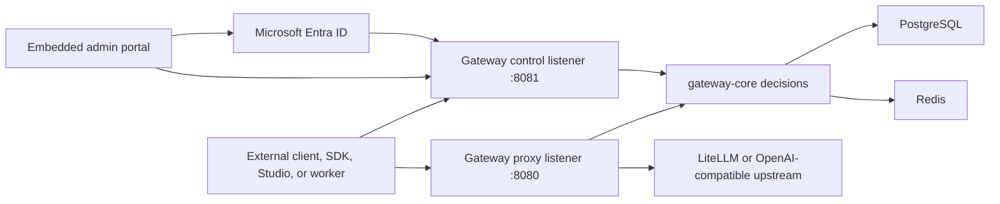

# Architecture

Relayna Gateway is designed as the public governance layer for AI traffic. Clients present Relayna virtual keys; the gateway resolves identity and policy, then translates approved requests to internal provider credentials.

## Request Flow

1. A client sends an OpenAI-compatible, Anthropic-compatible, or registered service request with Gateway credentials. With Entra disabled this is `Authorization: Bearer rk_live_...`; with Entra enabled the Entra JWT stays in `Authorization` and the Relayna key moves to the configured Relayna key header.
2. The proxy validates any configured Entra or trusted Apigee identity layer, extracts the Relayna key prefix, and loads the hashed key record from PostgreSQL.
3. Route precedence is explicit: Relayna control/admin/operational routes, registered service routes, canonical OpenAI-compatible and Anthropic-compatible routes, and then configurable LiteLLM wildcard passthrough for remaining allowed paths.
4. Globally disabled canonical LiteLLM routes are rejected before policy, rate-limit, and budget checks.
5. `gateway-core` verifies the key secret, disabled state, revocation state, expiry, allowed route, allowed model, allowed provider, streaming permission, service method permission, rate limit, and budget.
6. Redis request-per-minute, token-per-minute, and budget counters are checked
   and updated for rate limit and budget decisions.
7. The proxy strips client credentials and the downstream `Host`, then forwards
   the request with the configured internal upstream credential and a `Host`
   header derived from the selected upstream.
8. A usage event is written for success and failure paths with request, project, route, provider, latency, status, token, and cost fields when available.

Before routing or store access, both HTTP listeners share an admission limit of
64 active requests per process. At most 128 additional requests may wait, FIFO,
for up to 250 ms. The source limiter runs before joining this queue; queued
requests do not poll their bodies. Header, parser, and socket memory still exist
while waiting, so this is not a total connection or memory limit. The proxy releases this permit after its
request filter, before body upload and provider streaming. Control-plane
handlers hold it through request extraction and handler completion. Exact
static assets, liveness, and the in-memory metrics export are exempt. Authentication,
owner APIs, and LiteLLM aliases are covered. Core virtual-key and operator lookups also have a shared
64-operation limit for callers outside these HTTP adapters.

Malformed-credential and source/capacity denials without an authenticated key do
not write per-request database history. They remain in local counters and the
bounded live monitor. Other traffic without a key uses at most eight concurrent
history writes, without waiting for a slot. This prevents error logging from
bypassing authentication admission; historical denial detail can be absent under
load. Authenticated usage recording retains its existing behavior.

Virtual-key and operator-token Argon2 verification, plus runtime key generation,
share two blocking workers per process. At most eight distinct verification jobs can wait for a worker,
for at most 250 ms. Queue saturation or expiry returns
`503 authentication_overloaded`, with `Retry-After: 1`; it does not classify the credential as invalid. Cancellation releases a queued
request permit; started CPU work retains its worker permit until completion. These are
resource bounds, not throughput guarantees. Cold virtual-key verification
reloads state and checks expiry at completion; a changed ID/hash fails closed,
and a changed project is reflected in the returned identity. Operator state
changes during verification also fail closed. These checks narrow the race with
revocation; they do not lock identity state for a whole upstream request.

Concurrent cold virtual-key requests with the same process-HMAC proof share one
verification job **before** competing for crypto capacity. The proof binds the
key ID, presented secret, and full stored hash; a wrong secret or changed hash
cannot join a valid job. There are at most ten shared jobs, 63 followers per
proof and 64 followers across all proofs. Each subscriber waits at most one
second. Cancelling the first request does not cancel work needed by followers;
the bounded job completes even if all subscribers leave. A stalled blocking job
continues to hold its worker permit. Completion, panic, or runtime shutdown
removes its registry entry and wakes subscribers. Every successful cold
subscriber independently reloads and validates current database state, including
project changes, before authorization. Failures are shared only with current
subscribers and are never cached. Operator tokens and key generation retain the
same executor without proof sharing.

Successful virtual-key secret verification can be reused for 60 seconds within
one process, up to 1,024 proofs. Each proof binds the key ID, presented secret,
and complete stored Argon2 hash using a process-random HMAC; the cache retains
only the digest and verification time. Hits do not extend expiry. Every request
still loads current key state from PostgreSQL, rejects disabled/revoked/expired
keys, and records key use. Changed hashes miss the cache; a database failure
still fails closed. Cold, invalid, expired-cache, and evicted keys use the same
bounded Argon2 workers and unchanged hashing parameters. A five-second
maintenance task physically removes expired proofs even without new inserts;
logical expiry stays at 60 seconds. Owned raw virtual-key/verifier buffers use
zeroization and virtual-key debug formatting is redacted. This cannot erase all
copies held by HTTP parsers, libraries, allocator moves, or the operating system.

Before store work, duplicate or oversized credential headers and malformed key
text are rejected. Credential headers are limited to 16 KiB and Relayna/operator
keys to 1,024 bytes of printable ASCII without commas or internal whitespace.
Existing variable-length keys within those bounds remain supported. Per-source
token buckets default to 100 requests/second with a burst of 200, shared by both
listeners. They use only the transport peer IP (including canonical IPv4-mapped
IPv6), never forwarded headers. Unknown peers share a bucket. The map holds at
most 4,096 sources and expires fully refilled idle entries after 60 seconds; new sources at map
capacity receive an authentication-capacity 503. Source exhaustion returns
`429 source_rate_limit_exceeded` with `Retry-After: 1`. Failed attempts do not
disable a key. See [deployment controls](deployment.md#authentication-abuse-and-memory-protection)
for trusted ingress, NAT sizing, and Linux dump protection.

The existing `gateway_denials_total{kind="auth_admission"}` counters use
`route="proxy"` or `route="control"` to distinguish listeners. They also include
inner authentication overloads and overlap `kind="auth"`; do not add these
series to count unique rejected requests. The additive
`gateway_auth_admission_events_total{event="..."}` records the originating
capacity decision: `request_queue_full`, `request_timeout`, `source_capacity`,
`source_rate`, `lookup_full`, `crypto_queue_full`, `crypto_timeout`,
`proof_capacity`, `proof_timeout`, or `proof_unavailable`. `request_queued`,
`proof_leader`, `proof_shared`, and `cache_hit` describe admission work. These are
process-wide events with fixed labels and no credential identifiers. A shared
job's crypto rejection is counted once even if multiple subscribers receive a
503; subscriber timeouts are counted individually.
Control-plane readiness probes can be denied during saturation; those denials
must not be attributed to proxy clients. Resource-free liveness remains exempt.

Effective policy and guardrails reuse the layers loaded for the current lookup
when their project context matches. Policy state is not cached across requests.
Callers that omit project context retain the existing distinction between
inherited key policy and caller-context guardrails.

HTTP guardrails share a client and connection pool across calls, with bearer
credentials and deadlines applied per request. Their synchronous executor still
waits on an OS thread per call. Provider forwarding continues to use Pingora's
upstream pool; these changes do not increase provider inference speed or remove
upstream concurrency limits.

Buffered traffic can opt into a size-aware working-set bound. An additional
elastic mode replaces the ordinary count ceiling with an explicit larger safety
ceiling, allowing concurrency to follow available memory and body sizes. It
adds processing workspace only when the complete-body processing phase starts;
compact analyzed metadata releases temporary scratch space before asynchronous
policy lookups, with workspace reacquired for subsequent body processing.
An unavailable upgrade fails without waiting while holding a body. The released
defaults and serialized-byte ceiling remain unchanged. Declared lengths reserve estimated
capacity early, unknown-length uploads grow within shared capacity, and an
optional reserve protects declared small bodies. Growth and JSON serialization
check capacity before allocation; temporary workspace estimates remain distinct
from an exact RSS limit. Rewritten output has a separate allocation charge;
serialization preserves the original input extent and its processing workspace,
including for unknown-length uploads and shrinking rewrites. A separate optional upstream request/stream ceiling
spans the entire provider operation. See [mixed-body operation and limits](operations.md#mixed-body-sizes).

Canonical OpenAI-compatible and Anthropic-compatible routes can run in
`managed_by_gateway` mode or `direct_litellm_passthrough` mode. Direct mode
still enforces Relayna auth, route enablement, route/model/provider policy,
request and token rate limits, and budgets before forwarding to LiteLLM. It bypasses Gateway guardrail
rewriting and provider token accounting, so usage for that path is reduced.

Wildcard LiteLLM passthrough is for non-canonical LiteLLM paths such as
`/v1/models`. It is disabled by default, controlled by path/method allowlists,
and records status-only usage. Sensitive LiteLLM `/ui` and admin-like paths
have additional exposure modes:

- `disabled`: always blocked.
- `operator_only`: requires the Gateway Entra or trusted Apigee identity layer
  plus Relayna virtual-key auth.
- `explicitly_exposed`: allowed for authenticated Relayna virtual-key clients
  when also matched by the path/method allowlist.
- `trusted_ingress`: allows browser-safe LiteLLM UI access from trusted ingress
  without a client Relayna credential, while non-UI passthrough paths remain
  protected by normal Relayna authentication.

## Control Plane

The control listener exposes:

- `/admin-ui/healthz` for process liveness.
- `/admin-ui/readyz` for PostgreSQL and Redis readiness.
- `/admin-ui/metrics` for Prometheus scraping.
- `/admin-ui/admin/*` APIs for operator actions.
- `/admin-ui/auth/*` for the browser OIDC BFF protocol and portal session.
- `/owner/v1/services/{service-name}/*` for exact service-scoped monitoring.
- `/owner/v1/projects` for authorized project discovery.
- `/owner/v1/projects/{project-id}/*` for exact project-scoped monitoring and
  read-only virtual-key metadata inventory.
- `/admin-ui` for the embedded operator portal.

Version `0.1.0` extends this control plane with scoped
operator authorization, audit events, policy simulation, policy layers,
provider health state, debug bundles, service import versioning and rollback,
and expanded usage analytics. The public feature overview is in
[Current Feature Highlights](current-features.md).

Admin APIs accept an active Entra administrator session or an operator token.
On the first startup, the gateway bootstraps one operator token and stores only
its hash. `GATEWAY_ADMIN_TOKEN` can seed that first token in a fresh database;
otherwise the gateway generates and prints one raw token once. Use that token
as break-glass access to approve the first Entra administrator. After an active
token exists, env changes are ignored and rotation through the Admin portal is
the supported change path.

Owner APIs resolve the signed-in portal member or workload identity and inject
the exact authorized service or project into every store query. Browser OIDC
tokens never reach JavaScript, while managed identities must match tenant,
audience, application role, and an enabled exact resource binding.

`GET /owner/v1/projects` preserves the portal membership response and also
accepts verified owner Entra bearer tokens. Workload discovery queries only
projects whose enabled exact bindings match the verified tenant, `appid` (or
`azp`), optional bound object ID, and binding-required application role. Each
workload result has role `viewer`; a valid monitoring identity without matching
bindings receives an empty list. Administrator privileges do not grant an
owner-scope fallback.

`GET /owner/v1/projects/{project_id}/keys` requires the same exact project
membership or workload binding as project usage APIs. Its dedicated PostgreSQL
projection returns only key UUID, project UUID, name, safe prefix, disabled
state, revocation timestamp, and expiry. It includes unused keys and reflects
current key membership. A key moved between projects leaves historical usage
attributed to each event's persisted project ID. No per-key authorization or
key-management writes are added.

Owner dashboards expose incident time series, filtered request events, and
sanitized request details only within the exact service or project scope. A
missing request and a request owned by another resource return the same `404`
response, preventing request-ID enumeration. Project scope uses the persisted
usage-event project ID rather than service links.

Usage export endpoints are part of the admin surface:

- `/admin-ui/admin/usage/export.json`
- `/admin-ui/admin/usage/export.csv`

They use the same usage filters as the dashboard, include summary totals, and
return paginated rows. CSV output is escaped and spreadsheet formula prefixes
are neutralized before the response is sent.

The additive `project_key_services` dashboard breakdown groups persisted usage
events by project ID, virtual-key ID, and service name in one bounded aggregate
query. The Admin UI resolves those identifiers to project names and safe key
prefixes, then presents Project → Virtual key → Service disclosures. Existing
dashboard fields and the usage event schema remain unchanged.

## Crate Ownership

- `gateway-api` owns Axum routes, admin API handlers, request IDs, health, readiness, metrics, static admin UI serving, and process startup.
- `gateway-core` owns framework-agnostic authentication, policy, routing, service, rate limit, budget, usage, operator token, and error types.
- `gateway-proxy` owns Pingora proxy behavior, upstream request construction, credential stripping, provider routing, streaming behavior, and proxy usage accounting.
- `gateway-store` owns PostgreSQL migrations, SQLx access, Redis readiness, and Redis control state.
- `gateway-telemetry` owns tracing setup, log formatting, redaction helpers, and Prometheus output.

## Data Stores

PostgreSQL is the source of truth for durable state:

- Virtual key metadata and hashed key material.
- Policy fields for routes, models, providers, project and individual service
  links, streaming, tools, rate limits, and budgets.
- Usage events consumed by Relayna Studio and operators.
- Service registrations, Studio sync state, durable OpenAPI endpoint catalogs,
  and per-endpoint pricing rules.
- Global LiteLLM route enablement and mode selection for
  `/v1/chat/completions`, `/v1/responses`, `/v1/embeddings`, and the canonical
  `/v1/rerank` identity shared by `/rerank`, `/v1/rerank`, and `/v2/rerank`.
- LiteLLM wildcard passthrough settings for enablement, path/method
  allowlists, `/ui` exposure, and LiteLLM admin API exposure.
- Operator token hashes, roles, scopes, and append-only admin audit events.
- Portal members, exact service and project memberships, one-time OIDC
  transactions, opaque browser sessions, and exact managed-identity service
  and project bindings.
- Provider health state, request debug bundles, and service import snapshots.

Registered service routes support wildcard paths under `/services/<service-name>/*`. The route resolver can match `GET` for service wildcard traffic, but forwarding still requires the service registration to include `GET` in its allowed method set. OpenAI-compatible routes, LiteLLM rerank aliases, direct provider routes, and legacy named service routes remain `POST` routes.

Redis is the fast mutable state layer:

- Request-per-minute and token-per-minute counters.
- Daily and monthly budget counters.
- In-flight budget reservation keys.
- Readiness checks used by `/admin-ui/readyz`.
- Bounded, expiring per-process monitoring snapshots for cluster observation;
  this state is independent of proxy admission and durable Usage accounting.

PostgreSQL remains the durable usage ledger. On startup and periodic
reconciliation, Gateway can rebuild current daily and monthly Redis budget
counters from PostgreSQL usage events for keys that have configured budgets.

## Trust Boundaries

Provider credentials, LiteLLM service keys, LiteLLM virtual keys, internal
service tokens, and operator token hashes stay inside the gateway deployment
boundary. Clients should only receive Relayna virtual keys and, when enabled,
front-door identity tokens such as Entra JWTs. Logs and error responses must
not expose raw credentials, raw virtual keys, request prompts, or upstream
secrets. Gateway strips client credentials before provider calls and injects
only the internal credential selected for the upstream.
