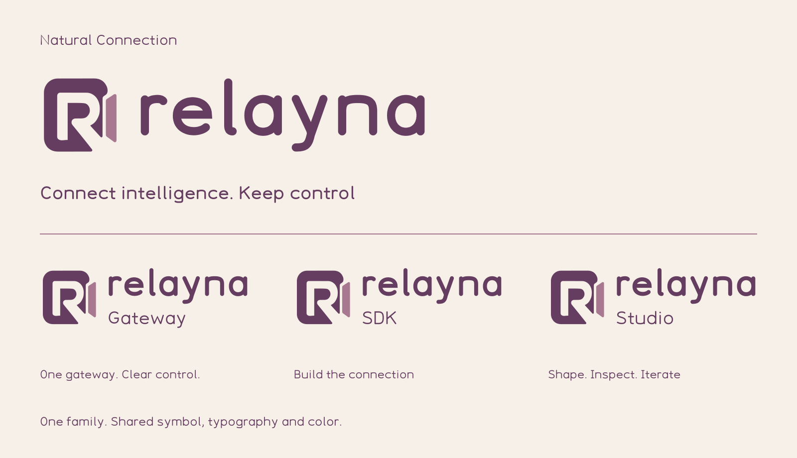
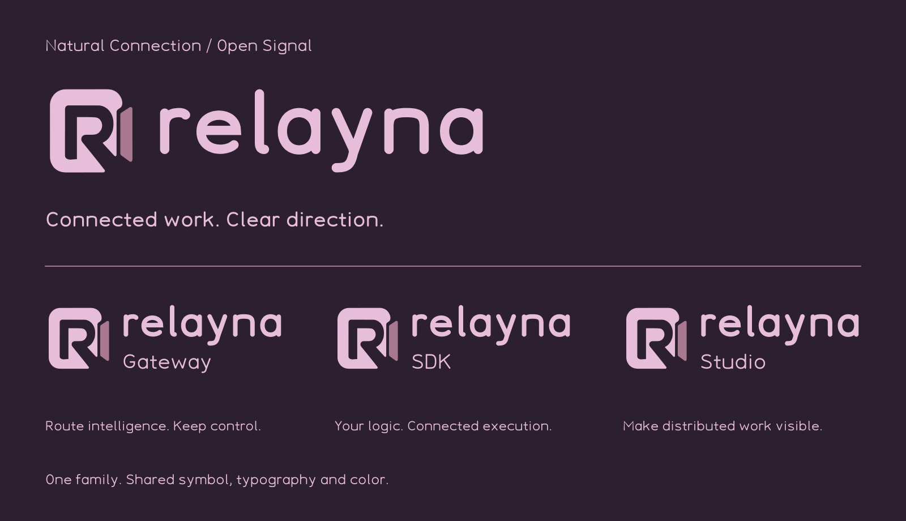
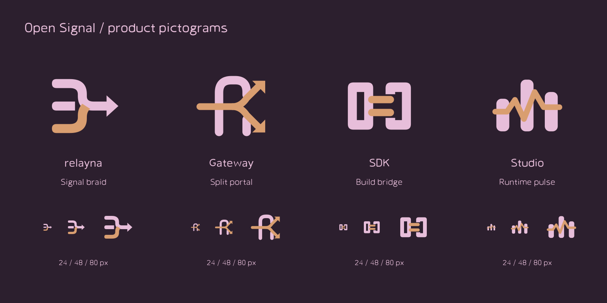

# Natural Connection

Relayna Gateway uses the shared **Natural Connection** identity: warm, rounded and composed. The selected **Slim Leaf** gateway symbol, original **Relayna Round** typography and **Mulberry & Linen** palette belong to one family across Gateway, SDK and Studio.

{ .brand-family-board .brand-light }

{ .brand-family-board .brand-dark }

## Identity and copy

| Identity | Exact tagline |
| --- | --- |
| relayna | Connected work. Clear direction. |
| Gateway | Route intelligence. Keep control. |
| SDK | Your logic. Connected execution. |
| Studio | Make distributed work visible. |

Keep the lowercase parent name and the displayed product capitalization. Preserve punctuation; line breaks may separate clauses without rewriting them. Use the supplied outlined logo lockups rather than recreating their lettering with live text.

## Color

| Anchor | Value | Purpose |
| --- | --- | --- |
| Mulberry | `#653D60` | Main logo, light-theme actions and brand type |
| Rose | `#A87891` | Slim leaf and supporting artwork |
| Copper | `#D99E70` | Warm highlights and connection ribbons |
| Linen | `#F7F0E8` | Main light canvas |
| Ink | `#2C1F2E` | Dark canvas and light-theme text |
| Blossom | `#E7BEDA` | Reverse logo and dark-theme actions |

Semantic tokens map these anchors and reviewed functional derivatives to surfaces, text, controls and charts. Green success, amber warning, red error and neutral unknown remain distinct from brand color. A palette change must not change metric meaning, health interpretation or authorization scope.

The Admin UI's existing `--rg-*` roles adapt to the shared `--rn-*` tokens. Light/Dark/System preferences retain their existing storage and event contract. The console, documentation and GitHub artwork use the same committed snapshot. Remote font services and a separate design-system checkout are not required to build or serve Gateway.

## Logo and banner assets

- [Parent logo](assets/brand/logos/relayna-light.svg) / [reverse](assets/brand/logos/relayna-dark.svg).
- [Gateway](assets/brand/logos/relayna-gateway-light.svg), [SDK](assets/brand/logos/relayna-sdk-light.svg) and [Studio](assets/brand/logos/relayna-studio-light.svg) lockups.
- [Standard symbol](assets/brand/logos/mark-light.svg) / [small optical symbol](assets/brand/logos/mark-small-light.svg).
- [Gateway banner](assets/brand/banners/relayna-gateway-wide-light.svg) / [dark banner](assets/brand/banners/relayna-gateway-wide-dark.svg).
- [Parent](assets/brand/banners/relayna-wide-light.svg), [SDK](assets/brand/banners/relayna-sdk-wide-light.svg) and [Studio](assets/brand/banners/relayna-studio-wide-light.svg) banners.
- [Logo-family board](assets/brand/banners/natural-connection-family-light.svg) / [dark board](assets/brand/banners/natural-connection-family-dark.svg).
- [Resolved tokens](assets/brand/tokens.json), [DTCG exchange tokens](assets/brand/design-tokens.json), [identity metadata](assets/brand/identity.json) and [checksums](assets/brand/manifest.json).

All logo files are native vector outlines. Keep the opening and two pieces intact, with clear space of at least one quarter of symbol height. Use the small optical master at 16–24 px and the standard master from 32 px. Monochrome, white and inline-currentColor variants accompany the two-color exports. An external SVG image does not inherit the page's currentColor.

The approved banner direction is **Open Signal**. Wide banners are 1600 × 600; native logo-family boards are 1600 × 920. Separate product-pictogram boards are 1600 × 800. Signal diagrams use reserved clear zones so connector lines stay outside each symbol. Sign-in uses the label-free Gateway diagram; dense working pages stay focused on data and controls. Do not add a large marketing banner above every request table.

## Open Signal product artwork

The owner selected **RT1 / GT4 / DT8 / ST4** and Studio **C — Runtime pulse** in design-system **0.1.1**. These supporting pictograms complement the Slim Leaf master:

| Product | Symbol | Meaning |
| --- | --- | --- |
| relayna | Signal braid | Connected services, tasks and workflows |
| Gateway | Split portal | Governed input and routed destinations |
| SDK | Build bridge | Service-side integration and execution plumbing |
| Studio | Runtime pulse | Operational visibility across services and workers |

{ .brand-family-board .brand-light }

{ .brand-family-board .brand-dark }

Studio is Relayna's operational control plane: service registry, task search, execution graphs, monitoring, failure investigation/retry and Chamber assessments. It is distinct from a creative design workspace. The SDK is service-side task/status/workflow plumbing; its artwork does not imply that SDK execution goes through Gateway.

[Product SVGs](assets/brand/pictograms/studio-dark.svg) and [label-free Gateway artwork](assets/brand/illustrations/relayna-gateway-open-signal-light.svg) accompany the native logo family. The snapshot's `pictograms.json` preserves the original selected contours. Keep at least 25% of symbol height clear around pictograms, including connector stroke caps. Never stretch a logo or redraw a pictogram approximately.

## Typography

Relayna Round provides five upright weights and a variable 300–700 axis. It includes Latin, extended Latin and Vietnamese accented Latin coverage. Semibold 600 sets the fixed wordmark; product descriptors use Regular 400. The UI self-hosts the original variable WOFF2; code and identifiers retain a system monospace stack. Charts use the same rounded face and repaint after the font loads without replacing data or canvas elements.

The typeface remains a **0.100 development draft**. No italics, manual hinting, Thai alphabet or complete native-platform font QA is claimed. Urbane Rounded was a mood reference; no proprietary font files or outlines are shipped. [Asset provenance](assets/brand/NOTICE.txt) records the source and current font status.

## Updating the snapshot

The complete editable source, font masters and reusable package live in the separate `relayna-design-system` project. Refresh from a reviewed checkout:

```sh
node scripts/sync-brand.mjs /path/to/relayna-design-system
npm run build:admin-ui
npm test
npm run typecheck:admin-ui
npm run test:react:coverage
```

The sync script verifies source checksums and copies a portable snapshot under `docs/assets/brand/`. It generates the UI's native SVG components and identity constants from the exact selected artwork. Normal Gateway builds read committed files only. A future font version needs a corresponding versioned embedded-asset route so immutable browser caches cannot retain a different font under the same name.

Verify all Admin and Owner views, sign-in/access states, tables and action drawers at desktop and mobile widths in both themes. Use the GET-only synthetic fixture from the [Admin Portal guide](admin-portal.md); keep production data and credentials out of captures.
