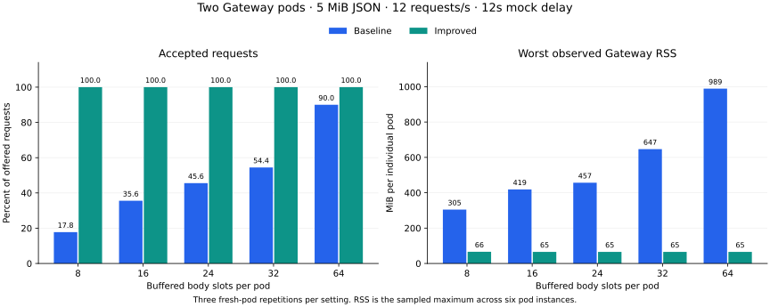

# Two-pod 5 MiB body admission benchmark

At **eight slots per pod**, the improved Gateway completed **540/540** requests,
compared with **96/540** before. Worst sampled individual-pod RSS fell from
**304.7 MiB to 66.1 MiB**
(78.3% lower).
Successful p95 remained about **12.1 seconds**, dominated by the mock delay.
All five improved settings completed every request in the controlled matrix.

The separate **64 RPS burst remained overloaded**. The improved image avoided
OOMs and transport failures at every limit, while larger limits traded more
memory for fewer 503s. These results support both fixing the implementation
and planning additional capacity for higher arrival rates.

[Interactive HTML (download/open)](comparison.html) · [Validated primary summary](summary.json) ·
[Burst summary](burst-summary.json) · [Image/source provenance](provenance.json) ·
[Reproduction commands](../../../benches/body-admission/README.md)

## Controlled comparison

| Control | Setting |
|---|---|
| Gateway replicas | Exactly two Ready Kubernetes pods; no autoscaling |
| Per-pod resources | 2 CPU limit, 2 GiB memory limit; requests 500m CPU / 256 MiB |
| Buffered body limits | 8, 16, 24, 32, 64 per process; 512 MiB serialized byte budget throughout |
| Request | Exactly 5,242,880 bytes of valid JSON, a single ASCII string payload |
| Arrival schedule | 12 requests/s for 15 seconds, 180 requests/run, round robin directly to pod IPs |
| Repetitions | Three fresh-pod repetitions per setting and version, 540 requests/setting |
| Mock | Hash/count streamed input, verify internal credential, wait 12 seconds, return small JSON |
| Real Gateway work | PostgreSQL virtual-key verification/policy/usage and Redis control state; unpriced service, no guardrails |
| Transport | HTTP/1.1 keepalive, no ingress, TLS, compression, or retries |
| Warmup | One verified 5 MiB request/pod on a zero-delay endpoint, then 500 ms idle |

| Slots/pod | Baseline 200s | Improved 200s | Baseline RSS MiB/pod | Improved RSS MiB/pod | Baseline cgroup MiB/pod | Improved cgroup MiB/pod |
|---:|---:|---:|---:|---:|---:|---:|
| 8 | 96/540 (17.8%) | 540/540 (100%) | 304.7 | 66.1 | 293.6 | 54.3 |
| 16 | 192/540 (35.6%) | 540/540 (100%) | 418.7 | 65.4 | 407.8 | 54.4 |
| 24 | 246/540 (45.6%) | 540/540 (100%) | 456.8 | 65.4 | 448.9 | 54.0 |
| 32 | 294/540 (54.4%) | 540/540 (100%) | 646.7 | 65.4 | 639.5 | 54.0 |
| 64 | 486/540 (90.0%) | 540/540 (100%) | 988.7 | 65.3 | 982.8 | 54.1 |

Memory columns show the **worst individual pod across six pod instances** per
condition, not the sum of both pods. RSS is sampled from `/proc/1/status` every
250 ms plus sampler overhead. Cgroup-v2 `memory.peak` captures the kernel high
water mark, including startup/warmup, file-cache charges, and the small sampler
processes. RSS includes shared resident pages; cgroup charge attribution differs.
Fresh Gateway pods prevent earlier runs' allocator history from contaminating
later conditions. Sampled RSS can miss short peaks.

## Timing and throughput

| Version | Slots/pod | Success p50 ms | Success p95 ms | Success TTFB p95 ms | Rejection p95 ms | Successes / arrival-window second | Median load + drain seconds |
|---|---:|---:|---:|---:|---:|---:|---:|
| baseline | 8 | 12085.4 | 12104.0 | 12103.9 | 62.0 | 2.13 | 25.50 |
| baseline | 16 | 12082.4 | 12094.4 | 12094.3 | 59.1 | 4.27 | 26.83 |
| baseline | 24 | 12082.9 | 12097.5 | 12097.4 | 59.9 | 5.47 | 27.00 |
| baseline | 32 | 12083.2 | 12102.9 | 12102.7 | 60.1 | 6.53 | 27.00 |
| baseline | 64 | 12084.0 | 12101.0 | 12100.9 | 60.9 | 10.80 | 27.00 |
| improved | 8 | 12090.9 | 12099.0 | 12098.9 | — | 12.00 | 27.01 |
| improved | 16 | 12091.6 | 12098.4 | 12098.3 | — | 12.00 | 27.01 |
| improved | 24 | 12091.7 | 12099.9 | 12099.9 | — | 12.00 | 27.00 |
| improved | 32 | 12092.6 | 12103.4 | 12103.4 | — | 12.00 | 27.01 |
| improved | 64 | 12091.3 | 12099.0 | 12098.9 | — | 12.00 | 27.00 |

Latencies use only successful requests; rejection timing is separate. TTFB is
request dispatch through response headers. End-to-end timing ends after the
complete response. Arrival-window throughput is successes divided by the
15-second offered-load window. It describes these finite cohorts; the raw
summary also retains throughput including response drain and each repetition's
wall time. Lower wall time with many rejections is not a latency improvement.
The fixed mock delay prevents this experiment from isolating pure Gateway CPU
or maximum sustained throughput.

## Admission evidence and validation

| Slots/pod | Baseline observed slots | Improved observed slots | Baseline buffered MiB | Improved buffered MiB | Baseline concurrency denials | Improved concurrency denials |
|---:|---:|---:|---:|---:|---:|---:|
| 8 | 8 | 1 | 40.0 | 5.0 | 444 | 0 |
| 16 | 16 | 1 | 80.0 | 5.0 | 348 | 0 |
| 24 | 24 | 1 | 120.0 | 5.0 | 294 | 0 |
| 32 | 32 | 1 | 160.0 | 5.0 | 246 | 0 |
| 64 | 64 | 1 | 320.0 | 5.0 | 54 | 0 |

All primary runs had zero byte-budget denials, transport errors, unexpected
HTTP statuses, restarts, or OOMs. Every observed 503 matched the concurrency
admission counter. Both pods received exactly 90 scheduled requests/run.
All successful bodies matched the original byte count, SHA-256, and expected
internal service credential. Observed buffered slots/bytes stayed within their
configured bounds. Generator dispatch p99 stayed below
2.3 ms;
no CPU quota throttling was observed in the controlled matrix.

`workload.mjs` and `mock.mjs` are byte-for-byte identical between primary
matrices. Their hashes and the common payload hash are in `provenance.json`.
`summarize.py` rejects differing controls/payloads, missing repetitions, uneven
pod traffic, unverified responses, limit overruns, metric scrape errors, and
mismatched admission counters.

## Why the implementation includes an allocator default

Two separately labeled eight-slot diagnostics used the same candidate binary,
12 RPS / 15-second workload, 12-second delay, and 2 GiB pod limit:

| Candidate configuration | Successes | Worst sampled RSS MiB/pod |
|---|---:|---:|
| Buffer ownership change, original allocator policy | 180/180 | 1122.4 |
| Same binary, `MALLOC_MMAP_THRESHOLD_=131072` | 180/180 | 65.7 |

See [owner-only diagnostic](owner-only-pilot/) and [allocator override](allocator-probe/).
This controlled override identifies allocation policy as a material contributor
to retained RSS. glibc documents that an explicit mmap threshold disables its
dynamic adjustment and allows freed large allocations to return to the OS.
[GNU libc documentation](https://sourceware.org/glibc/manual/latest/html_node/Memory-Allocation-Tunables.html).
The final image includes this setting by default; the primary improved matrix
uses no diagnostic allocator override.

## Higher-rate 1 GiB burst

Both versions used two pods, 2 CPU / **1 GiB per pod**, eight through 64 slots,
512 MiB serialized-body budget, 64 requests/s for five seconds (320 requests),
and a two-second mock delay. This supplemental sweep has **one trial/setting**.
It was run after the full three-repetition controlled comparison and remains
separate from its statistics.

| Version | Slots/pod | 200 / offered | 503 | Transport errors | OOM pods | RSS observed MiB/pod | Success p95 ms |
|---|---:|---:|---:|---:|---:|---:|---:|
| burst-baseline | 8 | 2 / 320 | 10 | 308 | 1 | 1011.4 | censored |
| burst-baseline | 16 | 0 / 320 | 1 | 319 | 2 | 951.3 | censored |
| burst-baseline | 24 | 1 / 320 | 4 | 315 | 2 | 1007.8 | censored |
| burst-baseline | 32 | 0 / 320 | 0 | 320 | 2 | 970.0 | censored |
| burst-baseline | 64 | 0 / 320 | 0 | 320 | 2 | 1008.0 | censored |
| burst-improved | 8 | 33 / 320 | 287 | 0 | 0 | 103.9 | 11191.6 |
| burst-improved | 16 | 58 / 320 | 262 | 0 | 0 | 146.3 | 11541.3 |
| burst-improved | 24 | 68 / 320 | 252 | 0 | 0 | 189.1 | 11552.0 |
| burst-improved | 32 | 89 / 320 | 231 | 0 | 0 | 231.3 | 11481.0 |
| burst-improved | 64 | 151 / 320 | 169 | 0 | 0 | 382.5 | 12193.8 |

OOM cases have censored memory/timing observations: sampled RSS is an observed
lower bound on their peak, successful-response samples exclude lost requests,
and metrics streams stop/reset during crashes. OOM pod counts come from saved
end-of-run Kubernetes status. These are availability failures, not valid tail
latency comparisons. The improved sweep had zero transport errors or OOMs;
its complete admission counters were also validated by `summarize.py`.

At the higher offered rate, increasing slots from eight to 64 raised completed
requests from **33 to 151 of 320**, while RSS rose from **103.9 to 382.5 MiB/pod**.
The two pods still returned 169 overload responses at 64 slots. More capacity
or further throughput/scheduling work is needed for that burst; raising the
slot limit alone did not meet the offered load. The tested controlled workload
needs no increase to the eight-slot default after this change.

Earlier exploratory [1 GiB overload](overload-probe-1gib/) and
[low-rate slot probes](slot-probe-1gib/) are retained for context. Their different
warmup/duration settings are excluded from the controlled comparison.

## Implementation and compatibility

- [Body admission](../../../crates/gateway-proxy/src/body_admission.rs) now owns
  forwarded `Bytes` through `Bytes::from_owner`; clones and queued writes keep
  the lease until the last reference drops. Completed uploads release slots
  without waiting for service response headers.
- [Proxy admission](../../../crates/gateway-proxy/src/pingora_plane.rs) still
  completes policy/guardrail checks before forwarding and checks rewritten
  byte growth before reserving a service charge.
- [The container](../../../Dockerfile) pins glibc's mmap threshold at 128 KiB.
  Native glibc deployments need the matching setting before process startup;
  other allocators/platforms can behave differently.
- Public routes, success/error shapes, credentials, schemas, Redis formats,
  policy decisions, and defaults of eight slots / 512 MiB remain compatible.
  Body limits govern retained serialized buffers, not every in-flight request
  or total pod RSS. Backpressured uploads still consume admission.

## Verification and provenance

The completed-upload process regression fails on the unmodified release and
passes with the fix. Ownership tests cover clones/slices, zero-copy transfer,
byte growth, and cancellation. The process test also proves an expanded-body
503 neither reaches the mock nor records a fixed service charge.

The full repository verification script passed, including live PostgreSQL/Redis
integration, Cargo formatting/Clippy/tests, audit with existing repository
exclusions, deny, machete, **437/437 Nextest tests with zero skips**, Trivy,
Gitleaks, and Semgrep. `cargo build --workspace --all-features`, the production
Dockerfile build check, and release metadata validation also passed. Verification
used a dedicated Redis base URL because a store test appends its own database
number. See the [ExecPlan](../../execplans/body-admission-benchmark.md).

The exported chart was visually inspected. The interactive report passed
desktop/light (728 px) and mobile/dark (360 px) rendering, selection-state
assertions, and a mobile horizontal-overflow check, with no console errors.

Measurements were collected on 2026-10-20 UTC in a local kind v1.36.1 cluster
on an aarch64 Docker Desktop Linux VM with 10 CPUs and 19.5 GiB RAM, on an
Apple Silicon macOS host. Dependencies: v22.23.3, PostgreSQL 16.15,
Redis 7.4.11, and ldd (Debian GLIBC 2.36-9+deb12u14) 2.36. The VM also had unrelated running containers, so host-level contention was
not isolated. No builds or verification scans from this task ran concurrently
with measurement.
These results describe this synthetic workload and hardware, with direct pod
routing and one JSON shape. Production ingress, CPU architecture, request mix,
backpressure, guardrails, and concurrency can change the result.

Baseline runtime source: `a089b57` / `v0.1.46`. Final runtime/container source:
`bcf92ad`. The reproduction guide freezes the original baseline Docker recipe
and builds it from an isolated release checkout. Exact image and binary hashes
are recorded in `provenance.json`; raw client observations, metrics, memory
samples, and pod status snapshots are preserved under each experiment directory.
