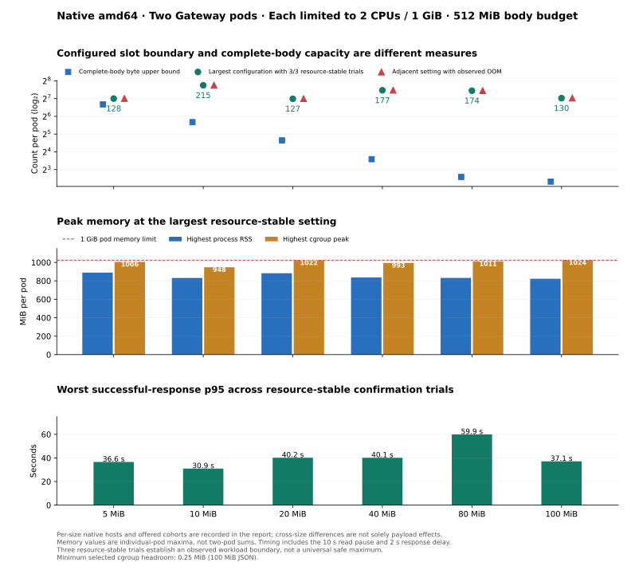

# Native amd64 JSON body resource boundaries

The six-size native amd64 resource sweep is complete. All primary observations
passed source, payload, architecture, resource and outcome validation.

The requested environment is two Gateway pods, **each** limited to **2 CPUs /
1 GiB**, with **512 MiB serialized-body admission budget per pod**. The user
selected a resource boundary, with latency reported separately and no latency
SLO. Every count and memory peak in the results is per pod unless specified.
The measured boundaries apply to this single-string JSON shape and burst/read-
backpressure workload; other JSON structures and arrival patterns can differ.

Runtime: published Gateway **v0.1.49**, source
[`48c93c0`](https://github.com/sarattha/relayna-gateway/commit/48c93c07d42b113b8073a403604b111871bf0fda),
immutable image index
`ghcr.io/sarattha/relayna-gateway@sha256:1b40a38f8c5f211d9c5b650a450c4645ee53149d1af7235599afdc133ea69f75`.
The [primary run manifest](primary-runs.json) records each native job and exact
harness commit. Verbatim harness source and independent validators are preserved
with the evidence.

## What a slot limit means

The configured slot maximum is a counter ceiling, not preallocated storage.
Resource settings alone therefore do not determine a universal maximum
configuration value. Offered concurrency, upload progress, JSON structure,
parsing, connection buffers, and other process allocations affect memory.

The byte budget gives these arithmetic upper bounds on simultaneously retained
**complete serialized bodies**. They are not guarantees that the process can
hold those bodies within its memory limit, nor limits on all in-flight
requests or total successful requests over a batch.

| Exact JSON body | Complete bodies per pod within 512 MiB | Both pods if balanced |
| --- | ---: | ---: |
| 5 MiB | 102 | 204 |
| 10 MiB | 51 | 102 |
| 20 MiB | 25 | 50 |
| 40 MiB | 12 | 24 |
| 80 MiB | 6 | 12 |
| 100 MiB | 5 | 10 |

Partial uploads can occupy more slots. The implementation accounts received
serialized bytes; that counter is not a resident-memory ceiling. See the
released [admission controller](https://github.com/sarattha/relayna-gateway/blob/48c93c07d42b113b8073a403604b111871bf0fda/crates/gateway-proxy/src/body_admission.rs)
and [body rewriter](https://github.com/sarattha/relayna-gateway/blob/48c93c07d42b113b8073a403604b111871bf0fda/crates/gateway-proxy/src/body_rewrite.rs).

The controller acquires a slot when a request starts buffering and reserves
received chunk lengths against the byte counter. Forwarded bytes retain that
lease until the last reference is dropped. The counter does not account all
allocation capacity, JSON analysis, HTTP connection state, allocator state or
kernel memory charged to the pod. The measured cgroup memory can therefore
approach 1 GiB while admitted serialized bytes remain below 512 MiB. This
experiment measures that resource edge; it does not profile which allocation
category caused each OOM. All primary resource-stable trials must return both
admission gauges to zero, so a passing trial also demonstrates lease recovery.

## Measured results

All six sizes are complete and independently validated: **217 primary trials / 434 fresh Gateway pods**. Final comparisons offered **1024 simultaneous requests per pod (2048 total)**.

| JSON | Largest 3/3 resource-stable setting | Adjacent setting with OOM | Peak RSS / cgroup at stable setting | Worst success p95 |
| --- | ---: | --- | ---: | ---: |
| 5 MiB | 128 slots/pod | 129: OOM 1/3 trials | 888.5 / 1005.7 MiB | 36.6 s |
| 10 MiB | 215 slots/pod | 216: OOM 2/3 trials | 830.9 / 947.5 MiB | 30.9 s |
| 20 MiB | 127 slots/pod | 128: OOM 1/3 trials | 882.5 / 1022.3 MiB | 40.2 s |
| 40 MiB | 177 slots/pod | 178: OOM 2/3 trials | 836.4 / 993.3 MiB | 40.1 s |
| 80 MiB | 174 slots/pod | 175: OOM 2/3 trials | 831.6 / 1010.8 MiB | 59.9 s |
| 100 MiB | 130 slots/pod | 131: OOM 1/3 trials | 822.3 / 1023.8 MiB | 37.1 s |

These are **observed resource edges, not production settings**. The 100 MiB edge leaves only 0.25 MiB of measured cgroup headroom. Three trials describe this fixture and host; timing and memory overlap vary between trials. The complete-body arithmetic bounds above remain separate from configured slot counts.

[Interactive comparison](comparison.html) · [Exportable figure](figures/summary.svg) · [Validated JSON](validated-summary.json) · [Every primary trial](trials.csv)



### Occupancy and outcomes

All slot/memory counts below are **per pod**. Success and denial counts are **both pods together per trial**. Lost-denial replies are totals across the three selected trials and remain client transport errors. Every admitted success verifies the exact byte count, digest and credential; both admission gauges return to zero.

| JSON | Peak occupied slots / admitted MiB | Verified successes per trial | Server concurrency / byte denials per trial | HTTP-clean trials / lost denial replies |
| --- | ---: | ---: | ---: | ---: |
| 5 MiB | 128 / 511.97 | 206 | 90–1625 / 217–1752 | 3/3 / 0 |
| 10 MiB | 215 / 511.91 | 104 | 992–1107 / 837–952 | 3/3 / 0 |
| 20 MiB | 127 / 511.94 | 50–51 | 484–798 / 1199–1514 | 3/3 / 0 |
| 40 MiB | 177 / 511.92 | 24–26 | 740–1057 / 965–1284 | 3/3 / 0 |
| 80 MiB | 174 / 511.95 | 12–16 | 1160–1311 / 725–872 | 3/3 / 0 |
| 100 MiB | 130 / 511.98 | 10 | 900–1134 / 904–1138 | 3/3 / 0 |

Both guards reject traffic at the selected boundaries. `gateway_overloaded` alone does not distinguish a concurrency denial from a byte-budget denial. The sampled byte gauges remain within 512 MiB even when the pod approaches its 1 GiB memory limit. Batch successes can exceed the simultaneous complete-body bound as earlier buffers drain.

### Timing at the selected setting

Each value is the maximum of that statistic over the three selected trials, not a pooled percentile. Success timing includes the fixture’s 10-second read pause and 2-second response delay. Batch elapsed includes draining the offered cohort; diagnostic observation is outside client timing.

| JSON | Worst per-trial success p50 / p95 / p99 | Worst rejection p95 | Maximum batch elapsed |
| --- | ---: | ---: | ---: |
| 5 MiB | 35.5 / 36.6 / 38.4 s | 26.6 s | 39.1 s |
| 10 MiB | 28.7 / 30.9 / 31.0 s | 19.5 s | 31.3 s |
| 20 MiB | 35.2 / 40.2 / 40.2 s | 28.1 s | 40.7 s |
| 40 MiB | 36.6 / 40.1 / 40.2 s | 29.5 s | 40.7 s |
| 80 MiB | 48.0 / 59.9 / 59.9 s | 41.0 s | 60.0 s |
| 100 MiB | 34.0 / 37.1 / 37.1 s | 26.3 s | 37.6 s |

Detailed JSON/CSV retain exact quantiles, dispatch lag, CPU throttling, counters and every outcome. The 80 MiB group completed without client errors, but its 59.9-second worst success p95 is close to the 60-second technical watchdog.

### Native host and provenance

Every host has four vCPUs shared by the two CPU-capped Gateway pods and test fixtures. CPU models differ; cross-size timing differences cannot be attributed solely to body size. All slot comparisons within a size stay on one host.

| JSON | Native CPU model | Final cohort / pod | All trials / with container failures | Primary run |
| --- | --- | ---: | ---: | --- |
| 5 MiB | Intel Xeon Platinum 8573C | 1024 | 44 / 12 | [39812510359](https://github.com/sarattha/relayna-gateway/actions/runs/39812510359) |
| 10 MiB | AMD EPYC 9V45 | 1024 | 22 / 5 | [39830138631](https://github.com/sarattha/relayna-gateway/actions/runs/39830138631) |
| 20 MiB | Intel Xeon Platinum 8573C | 1024 | 46 / 8 | [39826384990](https://github.com/sarattha/relayna-gateway/actions/runs/39826384990) |
| 40 MiB | AMD EPYC 7763 | 1024 | 27 / 7 | [39820691161](https://github.com/sarattha/relayna-gateway/actions/runs/39820691161) |
| 80 MiB | AMD EPYC 7763 | 1024 | 28 / 6 | [39820696151](https://github.com/sarattha/relayna-gateway/actions/runs/39820696151) |
| 100 MiB | AMD EPYC 9V74 | 1024 | 50 / 13 | [39830143142](https://github.com/sarattha/relayna-gateway/actions/runs/39830143142) |

The 5 MiB size completed before its sequential parent job was cancelled; its complete size dataset is validated independently. Partial later-size data from that parent remains historical evidence. Primary harness commits, per-trial resources, architecture assertions, immutable runtime provenance and raw hashes are preserved in the [primary manifest](primary-runs.json), [run index](run-index.json), and [raw evidence index](raw-evidence-sha256.json).

## Method and controls

- Native Ubuntu x86_64 host, native linux/amd64 published image, amd64 kind
  node. Architecture assertions precede measurement. Slot comparisons within
  each size stay on one host. The first size required more than forty minutes,
  so remaining sizes use independent native runs to avoid the original
  three-hour job watchdog. Retain hardware per size; cross-host latency
  differences cannot be attributed solely to payload size.
- Exactly two fresh Ready Gateway pods per trial. Each has CPU limit `2`,
  memory limit `1Gi`, body-byte budget `536870912`, and the tested slot limit.
  The image's shipped `MALLOC_MMAP_THRESHOLD_=131072` setting is retained.
  CPU/memory requests are 500m/256Mi. These are CPU caps, with fixtures sharing
  the four-vCPU runner; they are not dedicated CPU cores.
- Real PostgreSQL-backed keys/policies/usage and Redis state; a mock registered
  service streams the upload into a byte count and SHA-256 hash. Successful
  replies must verify exact size, digest, and upstream credentials.
- Exact-size JSON with a single string field: `{"payload":"xxx..."}` and
  `Content-Length`. No TLS,
  compression, retries, ingress, or load balancer. Equal offered cohorts go
  directly to the two pod IPs over HTTP/1.1. Client socket capacity scales
  with the cohort, above the former 256-socket cap.
- The upstream pauses reading for 10 seconds, then waits 2 seconds after the
  complete upload. A successful warmup per pod bypasses both delays. This is
  a backpressure resource test, separate from the earlier fast-reader/RPS
  experiments. Client timing includes these fixture delays.
- Each size starts with a fixed simultaneous cohort per pod equal to twice
  its largest discovery slot setting. If all settings remain resource-stable, both the
  tested ceiling and offered cohort double. The finite exploration bound is
  4096 configured slots; reaching it without a failure establishes a tested
  lower bound, not a universal maximum. Every trial records its offered load.
- Refinement and confirmations use the same final offered cohort. Single-run
  discovery is followed by three fresh-pod trials at candidate settings. A
  failed confirmation triggers refinement with the repeated criterion.
- Client requests have a 60-second absolute watchdog. Initial studies used a
  30-second inactivity timer; the first 10 MiB study showed that timer could
  abort otherwise healthy roughly 40-second responses. Its primary retry
  aligns socket inactivity with the existing 60-second watchdog. Other
  completed primary confirmation groups had no client timer expirations.
  Primary 5/20/40/80 MiB runs used 30-second socket inactivity; 10/100 MiB
  runs used 60 seconds. All 18 selected confirmation trials completed without
  client errors.
  Timeouts, unexpected responses, incomplete observations,
  and unsuccessful warmups remain explicit; none are relabeled as an OOM.
- Admission gauges/counters and per-pod RSS/cgroup memory/CPU throttling are
  sampled every 250 ms plus command overhead. Kernel `memory.peak` includes
  startup and warmup. Cgroup memory includes charged cache and sampler
  processes; RSS is process resident memory. These measures need not match.
- Keep immediate pod snapshots and observe pod status after diagnostics and
  another 10 seconds, outside measured client timing. Previous-container logs
  independently prove a termination/restart when immediate status is stale.
  `OOMKilled`, other terminations, and inferred restarts remain distinguishable.

“Resource-stable” means no observed container termination/restart, complete
memory and metric evidence, returned-to-zero admission gauges, and every
offered request reconciled to a verified successful response or a server
admission denial. A lost rejection response is permitted only when exactly
accounted for by the server denial counter gap; it remains a client transport
error in the report. A missing admitted response invalidates the trial. “Clean”
additionally requires zero client errors. This keeps response delivery and
latency separate from the requested resource boundary. Intentional 503
`gateway_overloaded` responses are allowed. Three resource-stable trials
establish an observed workload boundary, not a production safety guarantee.
Failed-run timing and sampled memory can be censored by process death; a low
last sample does not imply memory stayed below the limit.

Reported resource-stable-setting memory is the highest individual-pod
observation across its confirmation trials. Reported p95 is the worst per-trial
p95, not an average or pooled percentile. Detailed trial data retain p50, p95,
p99, rejection timing, CPU throttling, and dispatch lag.

## Reading the evidence

Raw observations are immutable in `runs/<run-id>/`. Verbatim copies of all
four scripts at each recorded harness commit live in `../verification/harnesses/`. Each completed primary size
has a source-pinned independent analysis in `analyses/<run-id>/`. Its validator
loads the analyzer from the recorded Git commit or its verbatim source
snapshot, verifies all four workload
hashes, image architecture/revision, exact payload digest, per-pod resource
settings, fresh pod identities, and every checkpointed trial field. Historical
strict-clean runs also satisfy the resource-stability criterion when clean.

The slot setting is `GATEWAY_MAX_BUFFERED_REQUESTS` **per process**. The memory
peak is the highest individual pod peak across the selected confirmation
trials. The displayed success p95 is the highest per-trial p95 across those
trials; it is neither a pooled percentile nor an average. The admitted-success
count is for **both pods together** over a complete batch, not simultaneous
body occupancy. Intentional 503s and transport errors stay distinct.

`resource_failure` records an observed termination/restart, including cases
where previous-container logs prove a restart before Kubernetes status catches
up. `oom_pods` records only an explicit `OOMKilled` reason. A failed sample can
be censored before the peak is collected. `admission_counter_gap` is server
admission denials minus received client 503 responses; a resource-stable trial
requires it to equal the number of client transport errors exactly. A positive
gap is not a successful delivered response. `clean` requires that gap and all
client errors to be zero. All returned success bodies must pass verification.

## Exploratory evidence and recovery

The [pilot](https://github.com/sarattha/relayna-gateway/actions/runs/39806500087)
validated exact 5/100 MiB bodies and retained buffers under read backpressure.
Its smaller 5 MiB cohort exercised at most 204 slots per pod, so it could not
establish a larger configuration boundary.

The [first full search](https://github.com/sarattha/relayna-gateway/actions/runs/39809024251)
found repeated 5 MiB OOMs at 512 configured slots with 1024 offered requests
per pod. A 256-slot condition lost connections while the immediate pod
snapshot still reported Ready/zero restarts; previous-container logs retrieved
seconds later proved both containers had restarted. At 10 MiB, a 259-slot
candidate passed twice and OOMed on the third trial. The exploratory run was
cancelled, retaining completed and partial artifacts. These observations led
to delayed-status capture and repeated-criterion refinement in the final
harness. Preserve them separately from the final comparison.

The initial selected 20 and 100 MiB searches stopped at a strict counter
assertion when a client lost a rejection reply after the server recorded its
denial. Their raw evidence is preserved in runs `39820686185` and
`39820701600`. The analyzer now records that discrepancy instead of aborting.
An attempted offline replay of the incomplete 20 MiB search required an
unmeasured point; no complete result was fabricated from partial data.

The initial selected 10 MiB search (`39820680177`) reported 39 strict-clean
slots, but 128-slot trials had healthy containers and roughly 40-second
responses interrupted by a 30-second socket-inactivity timer. That is not a
memory limit. Its final retry aligns inactivity with the already configured
60-second absolute watchdog; a real 35-second silent-response regression
verified the fix. The completed 5, 40 and 80 MiB confirmation groups had no
client timer expirations and adjacent OOMs, so their valid measurements remain
primary evidence.

The first 100 MiB retry (`39825735001`) stopped growth at 64 slots because of
one lost denial reply, with about 695 MiB cgroup memory and no container
failure. That is also not a memory limit. The final resource predicate allows
only exactly counter-accounted lost denial responses while still requiring
every admitted request to complete and verify. HTTP-clean results and lost
rejection replies remain visible separately. The final retries use that
resource criterion, matching the user's choice rather than introducing a
response-delivery SLO.

## Reproduction and verification

Run the manual workflow from the experiment branch:

```sh
gh workflow run body-admission-benchmark.yml \
  --repo sarattha/relayna-gateway \
  --ref test/body-admission-size-capacity-amd64 -f mode=full
```

Select one size with `-f body_mib=10` (also 5, 20, 40, 80, or 100) for an
independent run. Selected-size jobs have a six-hour watchdog; every individual
trial retains the same client and condition watchdogs and pod resources.

Each run records the actual harness/source/image/workload hashes and hardware;
GitHub-hosted CPU models may differ between runs. This command starts a fresh
native experiment rather than overwriting old observations.

The complete repository verification stack passed for the final harness,
including all 437 Nextest tests, formatting, Clippy, workspace tests, repository
dependency/security policy, full-history secret scan, and Semgrep. Focused
driver, real-artifact analysis, adaptive-search, and workflow checks also passed.
See [verification record](../verification/checks.json).

The final evidence can be independently revalidated from the repository root:

```sh
python3 internal/test-reports/body-admission-size-capacity/verification/aggregate.py
python3 internal/test-reports/body-admission-size-capacity/verification/comparison.py \
  internal/test-reports/body-admission-size-capacity/amd64 \
  --validated internal/test-reports/body-admission-size-capacity/amd64/validated-summary.json \
  --output internal/test-reports/body-admission-size-capacity/amd64/comparison.html
uv run --with matplotlib==3.11.2 python \
  internal/test-reports/body-admission-size-capacity/verification/plot.py \
  internal/test-reports/body-admission-size-capacity/amd64/validated-summary.json \
  --output internal/test-reports/body-admission-size-capacity/amd64/figures/summary.svg
```

`primary-runs.json` selects the six primary measurements. Historical evidence
remains in `run-index.json` and the raw run directories. The aggregate validator
requires three resource-stable trials and an adjacent observed OOM for every
primary result; it will not silently turn a finite search ceiling or a
client-timeout boundary into a memory limit. `raw-evidence-sha256.json` records
every preserved raw file's size and digest. Validation and plot generation run
on a separate machine after measurement and cannot affect native timing.
